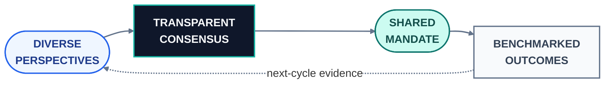
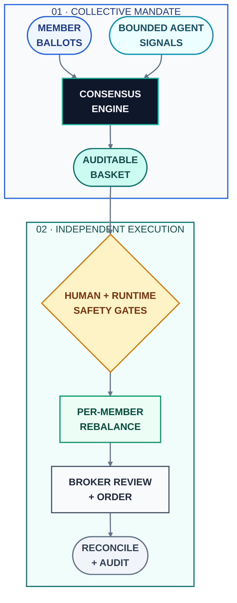

# Concordia — vote-governed portfolio execution

This README is the public technical overview and navigation guide for
Concordia. It explains the club's vote-governed investment model, independent
member-account execution, trading cycle, safety boundaries, technology stack,
and operating status, then directs readers to the detailed safety,
architecture, and design documents in this repository.

**Live demonstration: [demo.voteconcordia.com](https://demo.voteconcordia.com) — no sign-up; it opens straight into a demo member's account**

Concordia is a production-deployed, real-money investment club in which
portfolio construction is governed by member vote. During each trading cycle,
participants allocate 100% of their voting power across an S&P 500 universe.
The highest-conviction selections form a consensus basket, which Concordia
automatically rebalances inside each participant's independently owned
Robinhood account. Capital is never pooled, the club never assumes custody, and
the platform has no mechanism to deposit, withdraw, or transfer member funds.

> **Collective judgment, accountable influence, independent custody.**

## Goal

Concordia's goal is to test whether a diverse group can produce a more robust
portfolio decision than any single participant while keeping every judgment
measurable and every account independently controlled. It turns social
investment discussion into a repeatable operating loop: express conviction,
aggregate it transparently, execute one shared mandate, measure each call
against a benchmark, and feed the evidence into the next cycle.

The project does not assume that a majority is automatically correct or that
past performance guarantees future judgment. It is designed to make the
collective process inspectable: who expressed conviction, how influence was
calculated, what the group selected, what each account executed, and how those
decisions compared with the S&P 500.

## Why collective intelligence

The governing idea is not to follow conventional wisdom blindly. It is to make
the **wisdom of crowds** more disciplined by combining four conditions:

- **Diverse perspectives.** Human members vote beside 100 AI members, each
  running a distinct, named investment strategy, so different time horizons,
  sectors, and analytical styles meet on the same ballot.
- **Independent judgment.** Every participant allocates a complete ballot
  before the group result becomes the execution mandate.
- **Transparent aggregation.** Conviction is summed through one documented
  tally rather than selected by an opaque portfolio manager.
- **Measurable feedback.** Voting power is committed capital times a merit
  multiplier between 0.5× and 2×. The multiplier tracks each member's
  vote-weighted excess return over the S&P 500, blending a 13-cycle record
  (60%) with a 260-cycle record (40%), and is recalculated every two weeks,
  so one lucky call cannot swing the club.

**Running in shadow: an evidence-based voting rule.** A new rule runs beside
the live one without affecting it. Each week it scores every ballot against
the rest of the crowd, keeps a decaying record per member, and changes a
member's power only once that record clears a two-standard-error "luck dead
zone". Below the bar, power follows capital alone. In a 2007–2026 simulation
of 100 strategy-driven members, the rule cost nothing when no member had
skill, yet gave a planted star member 28% of the power, against 1.5% under the
live rule. It was chosen from about 45 variants after a review of about 50
papers. Picking a top-5 or top-10 sub-crowd, Condorcet log-odds weights, and
"surprisingly popular" voting all did worse.

The club has operated with real capital since July 2026. Private members
participate through their own accounts alongside AI voting members. Each AI
member votes through the Claude API on every S&P 500 name from a fixed set of
fundamentals and returns, and writes a thesis of at most 30 words. They hold no
account, no broker credentials, and cannot authorize execution; real orders
still require human participation, live-mode configuration, and explicit
runtime arming. The member agreement discloses that some voters are AI. Their ballots average a 0.032 correlation with one
another, which makes them roughly 24 effectively independent voters.

The public demonstration needs no account. It opens straight into a read-only
demo member whose balance, holdings, and chart come from the club's Alpaca
paper reference account, opened in August 2026 with $1,000,000 and shown
scaled to $1,000. The live club's forming consensus and track record sit
beside it, and every order remains simulated. The full onboarding (invitation code, emailed
verification, and the simulated brokerage connection) is available separately
at [demo2.voteconcordia.com](https://demo2.voteconcordia.com) with invitation
code `demo`.

## System at a glance

The platform coordinates one shared portfolio decision while preserving
independent account ownership, credentials, balances, broker review, and order
records for every member. The public demonstration shares product behavior,
not production authority or member data.

## What this repository demonstrates

| Engineering area | Public evidence |
|---|---|
| **Financial-system safety** | Independent execution gates, deterministic order identity, broker-side vetoes, stale-session refusal, and reconciliation against broker truth. |
| **Security and privacy architecture** | Encrypted per-member OAuth tokens, isolated application instances, member-scoped account access, and a deny-listed one-way public-data mirror. |
| **Workflow orchestration** | Auditable systemd timers coordinate voting, tallying, settlement-aware sells and buys, account snapshots, reporting, and backups. |
| **Full-stack product engineering** | One typed application supports member, administration, and public-demo experiences with origin-isolated sessions and role-specific shells. |
| **Data integrity** | Recorded and estimated observations remain distinguishable, presentation state is derived rather than destructive, and charts cannot render prices outside observed ranges. |

## Trading cycle

1. **Allocate.** Members distribute voting power across the securities they
   want the club to hold. Voting power blends committed capital with measured
   historical accuracy, recalculated every two weeks.
2. **Form consensus.** The ballot closes at 09:15 ET each Monday, and Concordia aggregates the votes into an approximately 20-security, conviction-weighted basket.
3. **Rebalance.** The executor independently aligns each participating account with the consensus mandate. Securities leaving the basket are sold, new constituents are purchased, overweight positions are trimmed, and correctly weighted holdovers remain untouched. Accounts with instant settlement sell and buy in the same run; cash accounts finish their buys the next trading day once sale proceeds settle (T+1). The system does not use margin.
4. **Measure.** Club-wide and member-level decisions are evaluated against an
   S&P 500 buy-and-hold benchmark, and the resulting accuracy evidence informs
   the next voting-power snapshot before the process repeats.

## Member app

The member app was rebuilt in November 2026:

- **Home** shows the account, holdings, and the current vote under one chart.
- **Research** offers ten stock lists, sector moves, a watchlist, a page per
  stock, news from Federal Reserve press releases and SEC EDGAR filings, and a
  fear-and-greed gauge. Market data is read through the member's own
  Robinhood connection and cached per member.
- **History**, **Account**, and **Leave the club** pages replace the old club
  tab. Sign-in and onboarding were redesigned.
- **Stakes** come in two forms. A dollar stake works like an automatic
  allocation, so shares a member sells by hand are bought back. A percentage
  stake stays a share of the account, so new cash joins it automatically.
- **Trade approvals.** Members whose Robinhood account holds every order for
  manual approval are detected and warned before the trading run.

## Technical documentation

- **[Engineering case study](docs/ENGINEERING.md)** — Provides an employer-oriented account of the system's scope, trust boundaries, hardest implementation problems, and verification strategy without exposing private source or member data.
- **[Safety](docs/SAFETY.md)** — Defines the independent conditions required before the system may place a real order, together with the stale-session guard introduced after a near miss could have repurchased a basket the club had exited six cycles earlier.
- **[Architecture](docs/ARCHITECTURE.md)** — Describes two isolated instances of one codebase on a single server and the one-way file boundary that exposes the live club's aggregate track record to the public demonstration without granting access to production credentials or member data.
- **[Design](docs/DESIGN.md)** — Records the product and data-integrity decisions behind the system, including the removal of Catmull–Rom chart smoothing after measured renderings exceeded the true price range in 13 of 15 symbol-and-window combinations.

These documents include focused excerpts from the private production repository. The complete source remains private because the platform executes real orders through connected member accounts.

## Technology

FastAPI; SQLite in WAL mode; Next.js 14, React, TypeScript, Tailwind, and
three.js; systemd services and timers behind nginx on a single Linux server;
per-member Robinhood OAuth through MCP; the Anthropic Claude API for the AI
members; the Alpaca paper API for the reference account; and more than 900
backend test functions across governance, execution, authentication, market
data, reconciliation, and public-demo boundaries.

## Operating status

As of November 20, 2026, across 52 decided sessions since June 17, the club's
paper decisions index stands at +5.6% against the S&P 500's −6.9%.

Production membership remains invitation-only, with a public waitlist at
[voteconcordia.com](https://voteconcordia.com). The public demonstration is read-only and always available; accounts created on the onboarding demonstration at demo2.voteconcordia.com retain their voting and performance history between visits.

## Related project

The [Agentic Research & Trading Platform](https://github.com/rohanjoglekar/agentic-research-trading-platform)
uses AI agents and rule-based code to research about 600 US stocks, build DCF
models from SEC filings, and run two paper trading books against the S&P 500.
[Live demo](https://agentic-research-trading.vercel.app/demo).

Contact: rohannj29@gmail.com

Code excerpts in `docs/` are published for technical review; all rights reserved.
